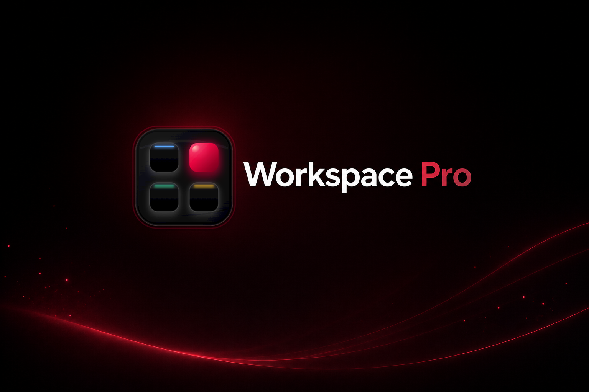
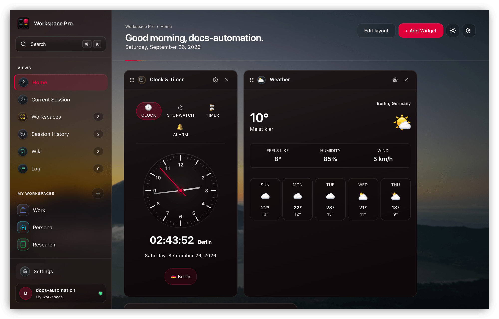
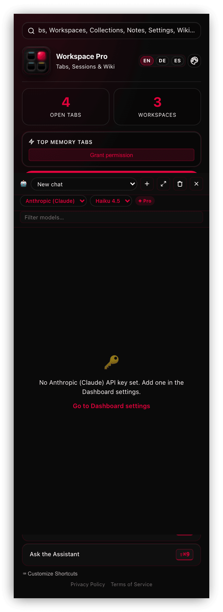
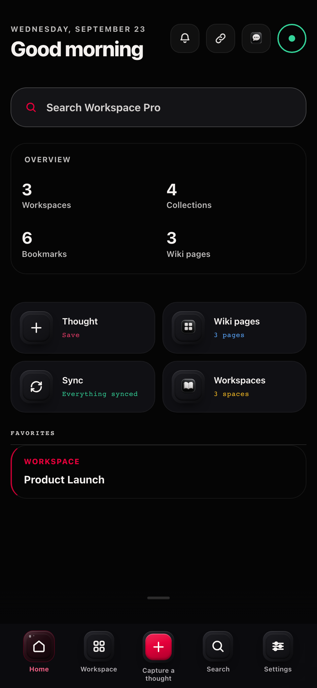
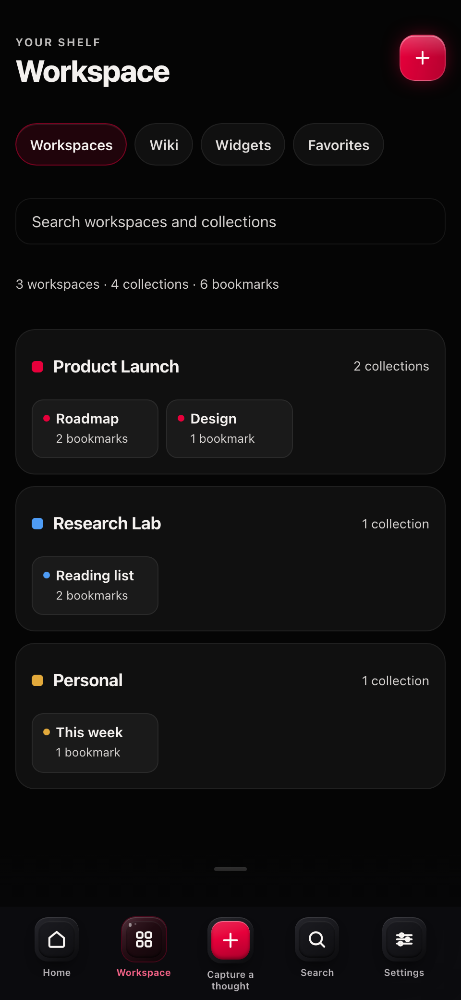
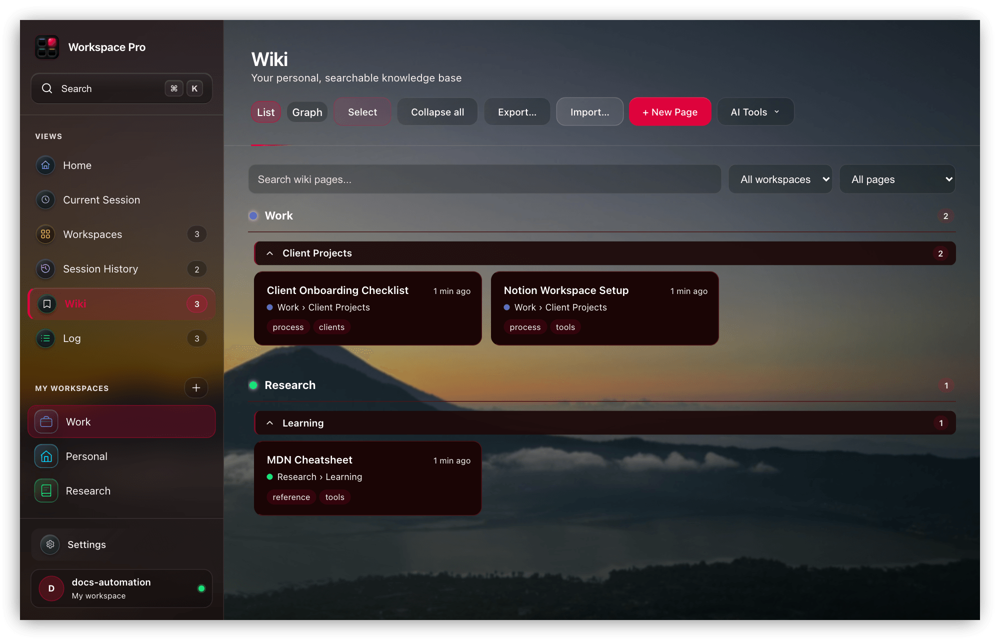
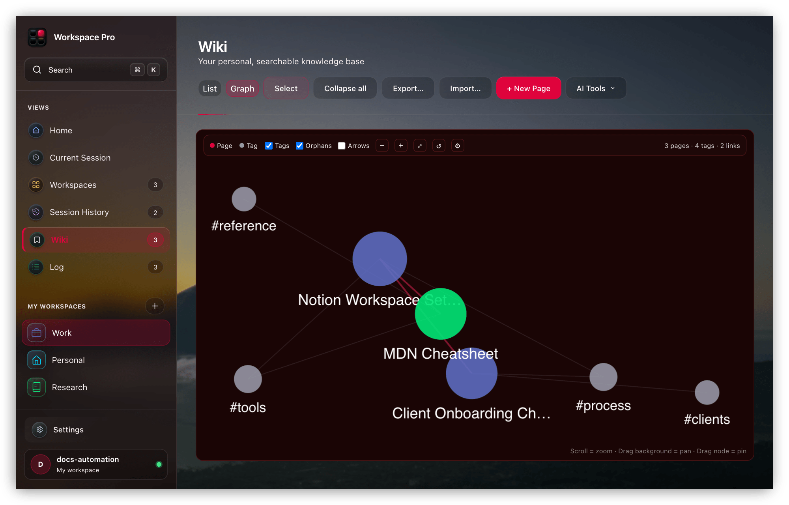
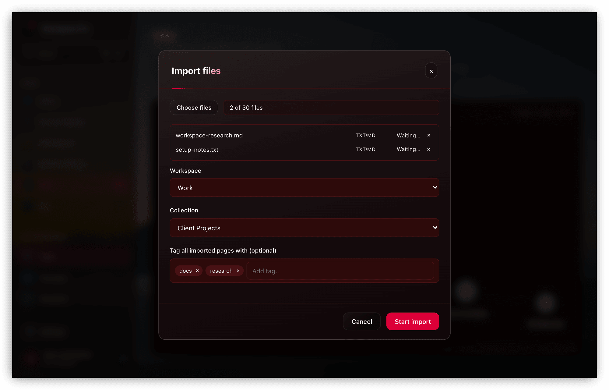
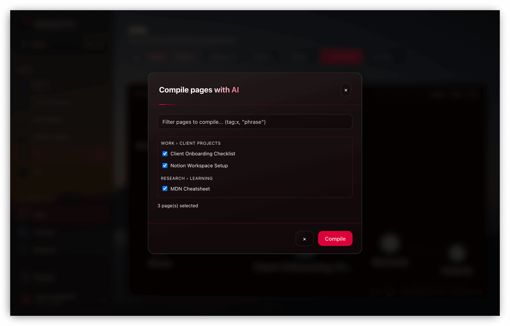
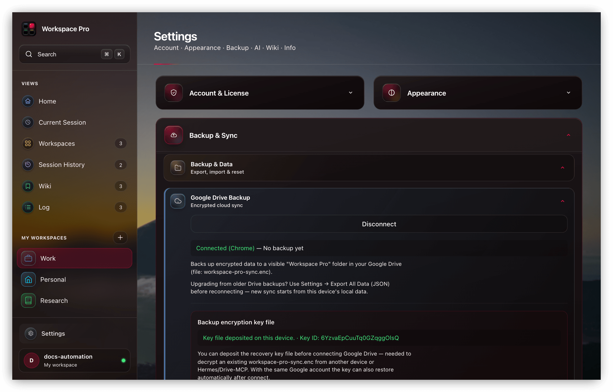

**Your Browser. Your Rules.**

Tab & session management for power users — built for developers, homelab enthusiasts, and IT professionals.

[Website](https://workspace-pro.app) · [Documentation](https://workspace-pro.app/docs) · [Chrome Web Store](https://chrome.google.com/webstore/detail/jplhkjcdmpchejmdjjdckpbhdognoknm) · [Report a Bug](https://github.com/Br3akTheBr33d/Workspace-Pro-Offical/issues/new?template=bug_report.yml) · [Request a Feature](https://github.com/Br3akTheBr33d/Workspace-Pro-Offical/issues/new?template=feature_request.yml)

---

## Workspace Pro v1.3.3 — Live on the Chrome Web Store

Workspace Pro turns every new tab into a local-first command center for your browser. Organize tabs into workspaces and collections, restore saved sessions, keep a personal searchable Wiki of clipped pages, and use an optional Pro dashboard for multi-provider AI tools, widgets, and private Google Drive sync.

**v1.3.3** makes licenses easier to enter and better protected. **v1.3.2** brought tasks and calendar together, with public holidays, week numbers and a new popup block for tasks and focus.

> Built for power users who live in the browser. Works on Chrome, Brave, Edge, and other Chromium-based browsers.

---

## What’s new

### v1.3.3 — Short License Key & Safer License Check
*November 19, 2026*

- Short license key: type it by hand instead of pasting the long key (Settings → license card)
- The key is hidden in the activation field and on the Pro card; the eye button shows it, “Copy” always copies the full key
- The Pro check uses a license-server confirmation that stays valid for up to 7 days offline
- Pairing an AI assistant through Drive (Agent Connect) requires an active Pro license

### v1.3.2 — Tasks & Calendar Together, Holidays, New Popup
*November 17, 2026*

- Edit tasks right in the calendar; drag tasks into the month view to set the due date
- Calendar: sortable and hideable calendars, default calendar, repeating events (daily to yearly), work week view, calendar weeks
- Public holidays for Germany, Austria, Switzerland, Spain, USA and the United Kingdom, calculated offline
- Popup: new “Tasks & Focus” block with Today, Week and Backlog, focus timer, popup layouts backed up with Google Drive
- Every change shows up in the activity log

### v1.3.1 — Fixes & Smaller Improvements
*November 5, 2026*

- Today widget and popup: day arrows, date picker and check-off for events
- The Assistant knows today’s date, weekday and time zone
- Workspace cards give the title more room; date pickers follow your theme

### v1.2.2 — Drive Recovery, Wiki Preview & Cross-Device Sync
*October 3, 2026*

- Recovery code for encrypted Drive backups when reconnecting (clear restore progress)
- Devices & agents under Settings → Google Drive (paired phones/AI clients, revoke, re-pair)
- Agent Connect centers on Drive MCP: one setup flow, privacy confirmation, live status
- Wiki list redesign: list/cards, side preview, keyboard nav, PDF export, accent-safe filenames
- Workspaces/Collections: select, collapse-all, bulk delete, multi-move
- Icon picker (line icons + emojis, optional color); clearer EN/DE/ES Settings & recovery copy
- Mobile Companion is updated independently of the browser extension

### v1.2.1 — Hybrid Wiki Search, Drive Auto Sync & Popup Workflows

- Hybrid Wiki search coverage
- Drive Auto Sync for workspace & Wiki changes (including clips)
- Popup workflows for clips and sessions

[Full changelog →](https://workspace-pro.app/changelog.html)

---

## Features in v1.3.3

### Free

| Feature | What it does |
|---|---|
| **Workspaces & Collections** | Organize projects, clients, and contexts; save tabs with notes and sticky notes. Select, collapse-all, bulk delete, and multi-move when you need them. |
| **Session History** | Keep up to 50 saved browser sessions and restore them when needed. |
| **Current Session** | Search and manage your currently open tabs. |
| **Personalization** | Eight dark-first themes, custom colors, readability controls, icon picker (line icons + emojis), and English, German, or Spanish UI. |
| **Local-first data** | Workspace data remains on your device by default. |

### Pro

| Feature | What it does |
|---|---|
| **Unlimited organization** | Remove free-tier workspace and collection limits. |
| **Personal Wiki** | Clip pages into a local, full-text-searchable knowledge base with tags, `[[wikilinks]]`, backlinks, visual graph, list/cards + side preview, keyboard nav, and PDF export. |
| **AI tab tools** | Group tabs by category, domain, or your AI provider and summarize open tabs. |
| **Workspace Pro Assistant** | Chat with your own Claude, OpenAI, or OpenRouter key, browse live model lists, attach files, and act on contextual browser and Wiki tools. |
| **Dashboard widgets** | Add, resize, and arrange Clock & Timer, Weather, News, Notepad, Assistant, Countdown, and Quick Links widgets. |
| **Tab Resource Monitor** | Find memory-heavy tabs quickly; Sessions view unifies tabs, windows, groups, and memory. |
| **Mobile Companion** | Workspaces, Collections, Wiki, and Widgets on phone and tablet with encrypted two-way sync through your private Google Drive — the unlock key stays on your devices. The Companion is updated independently of the browser extension. |
| **Agent Connect** | MCP server for AI clients (Hermes, OpenClaw, Claude Desktop/Code, Cursor, Codex, and any MCP client). Drive MCP is the center of the setup: one flow, privacy confirmation, and live status. Pair under Settings → Agent Bridge / Google Drive. |
| **Encrypted Google Drive sync** | Your data is encrypted before it reaches Google Drive. A recovery code helps when you reconnect, you can manage connected phones and AI assistants, change your key, and restore earlier versions. |

---

## Mobile Companion

Your workspaces now fit in your pocket. The [Mobile Companion](https://app.workspace-pro.app) is a progressive web app for phones and tablets — Workspaces, Collections, Wiki, and Widgets, installed from the browser with no app-store account.

Data syncs through your own encrypted file in your private Google Drive. The unlock key travels in the pairing URL fragment (QR) and never reaches a Workspace Pro server — it lives on your devices.

The Companion is updated independently of the browser extension.

  
  &nbsp;&nbsp;
  

[Open the Companion →](https://app.workspace-pro.app) · [News & overview →](https://workspace-pro.app/news.html)

---

## Agent Connect

Workspace Pro is an MCP server your AI can use. Agent Connect works with Hermes, OpenClaw, Claude Desktop, Claude Code, Cursor, Codex, and any MCP-compatible client.

| Mode | What you get |
|---|---|
| **With browser** | Live tabs and browser context while your browser is open. |
| **Without computer / Drive MCP** | Wiki, Workspaces, Collections, bookmarks, and notes against your encrypted Google Drive — no live tabs. One setup flow, privacy confirmation, and live status when your client is active. |

Pairing is one paste from **Settings → Agent Bridge**. The pairing code is chat-safe and expires in about ten minutes.

[Agent Connect docs →](https://workspace-pro.app/docs#doc-agent-connect) · [Agent Connect page →](https://workspace-pro.app/agent-connect.html)

---

## Personal Wiki

Clip any page from the dashboard or popup and it becomes a local Wiki page — Markdown content, editable metadata, tags, and notes, all stored on your device. Full-text search supports operators like `tag:`, `title:`, and `-exclude`, pages link to each other with `[[wikilinks]]`, and a visual graph shows how everything connects. Browse in list or cards with a side preview, keyboard navigation, and PDF export with accent-safe filenames.

Bring in existing notes with **bulk import** (Markdown, text, Word, Excel, and images) in one batch, or export any page — or the whole Wiki — as Obsidian-compatible Markdown.

Everything above is local and works without AI. If you add your own provider key, optional **Compile**, **Lint**, and **Ask Wiki** workflows can synthesize new pages, flag orphaned or broken links, and answer questions grounded only in your own Wiki content — every AI call is opt-in, requires explicit consent, and is logged in an activity log you can review.

[Read the full Wiki guide in the documentation →](https://workspace-pro.app/docs#doc-wiki)

---

## Dashboard widgets

| Widget | Highlights |
|---|---|
| **Clock & Timer** | World clocks, stopwatch, timer, and alarms. |
| **Weather** | Five-day forecast from Open-Meteo; no API key required. |
| **News** | RSS-based tech and AI news with topic filters. |
| **Notepad** | Multi-page rich text notes with headings and lists. |
| **Workspace Pro Assistant** | Persistent AI chat using your Claude, OpenAI, or OpenRouter key. |
| **Countdown** | Recurring deadlines with Chrome notifications. |
| **Quick Links** | Pinned shortcuts with favicons and emoji. |

---

## Keyboard shortcuts

| Action | Windows / Linux | Mac |
|---|---|---|
| Open Popup | `Ctrl + Shift + 1` | `⌘ + Shift + 1` |
| Open Dashboard | `Ctrl + Shift + 2` | `⌘ + Shift + 2` |
| Open Workspace Pro Assistant | `Ctrl + Shift + 9` | `⌘ + Shift + 9` |
| Close any modal | `Esc` | `Esc` |
| Save a form | `Enter` | `Enter` |
| Save a note | `Ctrl + Enter` | `⌘ + Enter` |

Default shortcuts can be changed in `chrome://extensions/shortcuts`.

---

## Privacy, sync, and backup

Workspace Pro has no analytics, tracking, or advertising. The Wiki is stored locally like the rest of your workspace data. Optional AI actions (tab tools, Assistant, or Wiki Compile/Lint/Ask) send only the content needed for the action you explicitly start, to the provider you configured.

Optional **encrypted two-way Google Drive sync** stores only encrypted data in a private app folder of your Google Drive (not visible in "My Drive"), supports a recovery code when reconnecting plus management of connected devices and assistants, keeps earlier versions you can restore, and merges edits from desktop and Mobile Companion instead of overwriting. License validation uses a pseudonymous device token rather than workspace data.

[Drive encryption docs →](https://workspace-pro.app/docs#doc-drive-encryption) · [Encryption overview →](https://workspace-pro.app/encryption.html) · [Privacy Policy](https://workspace-pro.app/privacy-policy) · [Terms of Service](https://workspace-pro.app/terms)

---

## Pricing

**Start free. Upgrade when you need more.**

| | Free | Pro |
|---|---|---|
| **Price** | €0 | One-time license key |
| **Workspaces** | 1 | Unlimited |
| **Collections** | 1 per workspace | Unlimited |
| **Session History** | Up to 50 saves | Up to 50 saves |
| **Themes & languages** | All themes; EN / DE / ES | All themes; EN / DE / ES |
| **Wiki, widgets, AI & Drive sync** | — | Included |
| **Mobile Companion** | — | Included |
| **Agent Connect** | — | Included |

[Get Pro License →](https://workspace-pro.app/#pricing)

---

## Bug reports and feature requests

This repository is the public issue tracker for Workspace Pro.

- **Found a bug?** → [Open a Bug Report](https://github.com/Br3akTheBr33d/Workspace-Pro-Offical/issues/new?template=bug_report.yml)
- **Have an idea?** → [Request a Feature](https://github.com/Br3akTheBr33d/Workspace-Pro-Offical/issues/new?template=feature_request.yml)
- **Need help?** → [Contact support](https://workspace-pro.app/contact) or email [support@workspace-pro.app](mailto:support@workspace-pro.app)

---

© 2026 Workspace Pro · [workspace-pro.app](https://workspace-pro.app)

*Not affiliated with Google, Brave Software, or Microsoft.*

